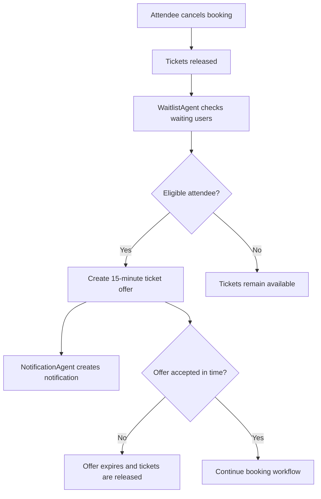

<div align="center">

# 🎟️ EventSphere

### Multi-Agent Event Management System

*From event discovery to ticket check-in, powered by collaborating software agents.*

**IT4123 · Agent Based Computing (ICA 02)**  
**University of Vavuniya**

[](https://www.python.org/) [](https://fastapi.tiangolo.com/) [](https://www.sqlite.org/) [](https://aws.amazon.com/ec2/) [](#testing)

**[🌐 Live Application](https://eventsphere-safiya.duckdns.org)** · **[💻 GitHub Repository](https://github.com/KalafSafiya/EventSphere)** · **[🚀 Run Locally](#run-locally)** · **[🧪 Tests](#testing)**

</div>

---

## ✨ What is EventSphere?

EventSphere is a web-based event management platform I built to explore **agent-based computing** in a practical setting. Attendees can discover events, book tickets, complete simulated payments, receive QR tickets, and join waitlists. Administrators manage events and venues, while Gate Staff handle ticket check-in.

Behind these features, **five software agents** take responsibility for different tasks and exchange messages through a dispatcher. For example, when a booking is cancelled, released tickets can be offered to someone on the waitlist, with a notification created automatically.

### At a glance

| 🎫 Booking & QR tickets | ⏳ Smart waitlists | 🏛️ Venue management |
|---|---|---|
| Ticket availability, simulated payments, and duplicate check-in protection | Time-limited offers and ticket release | Private-hire requests and conflict checks |

| 👤 Attendee | 🛡️ Gate Staff | ⚙️ Admin |
|---|---|---|
| Browse, book, and view tickets | Validate tickets at entry | Manage events, venues, and staff roles |

> **Note:** Payments are simulated. No real money is collected.

## 🤖 Meet the agents

| Agent | Responsibility |
|---|---|
| **BookingAgent** | Checks availability and reserves tickets |
| **TicketAgent** | Generates and validates QR tickets |
| **WaitlistAgent** | Manages waiting users and 15-minute ticket offers |
| **NotificationAgent** | Creates in-app notifications |
| **VenueAgent** | Checks venue availability and private-hire conflicts |

### How they work together

A booking cancellation is one example of agent collaboration:



The agents operate inside the same FastAPI application and exchange messages through a dispatcher. Messages record the sender, receiver, performative (such as `REQUEST`, `INFORM`, or `FAILURE`), content, conversation ID, and time. Administrators can view the agent message log.

## 🌐 Try the live application

**Live URL:** https://eventsphere-safiya.duckdns.org  
**Repository:** https://github.com/KalafSafiya/EventSphere

### Demo accounts

| Role | Email | Password |
|---|---|---|
| Admin | `REPLACE_WITH_ADMIN_DEMO_EMAIL` | `REPLACE_WITH_DEMO_PASSWORD` |
| Gate Staff | `REPLACE_WITH_STAFF_DEMO_EMAIL` | `REPLACE_WITH_DEMO_PASSWORD` |
| Attendee | `REPLACE_WITH_ATTENDEE_DEMO_EMAIL` | `REPLACE_WITH_DEMO_PASSWORD` |

> **Before submission:** Replace these placeholders with working, dedicated demo accounts. Avoid publishing passwords for personal or production accounts. If the repository is public, remember that anyone can see the credentials.

## 🛠️ Built with

**Backend:** Python, FastAPI, SQLAlchemy, APScheduler  
**Frontend:** HTML, CSS, JavaScript, Bootstrap, Jinja2  
**Database:** SQLite  
**Ticketing:** Python `qrcode`  
**Testing:** pytest  
**Deployment:** AWS EC2 (Ubuntu), Uvicorn, systemd, DuckDNS, HTTPS

## 🚀 Run locally

<details>
<summary><strong>1. Clone and set up the project</strong></summary>

Make sure Python and Git are installed.

```bash
git clone https://github.com/KalafSafiya/EventSphere.git
cd EventSphere
git checkout develop
python -m venv .venv
```

Activate the environment:

**Windows Command Prompt**
```cmd
.venv\Scripts\activate.bat
```

**Linux / macOS**
```bash
source .venv/bin/activate
```

Install dependencies:

```bash
python -m pip install -r requirements.txt
```

Run these commands from the directory containing `requirements.txt` and `app/`.

</details>

<details>
<summary><strong>2. Configure environment variables</strong></summary>

EventSphere reads its database connection from `DATABASE_URL`. If this variable is not set, the application defaults to a local SQLite file:

```env
DATABASE_URL=sqlite:///./eventsphere.db
```

| Variable | Purpose | Example |
|---|---|---|
| `DATABASE_URL` | Database connection | `sqlite:///./eventsphere.db` |

**Configuration check before submission:** Review the project's authentication and deployment configuration and document any additional required environment-variable **names** here, with safe example values. Do not copy the production `/etc/eventsphere.env` file or publish secret keys.

The application creates its database tables when it starts.

</details>

<details>
<summary><strong>3. Start EventSphere</strong></summary>

```bash
python -m uvicorn app.main:app --reload
```

Open the application at **http://127.0.0.1:8000**.

FastAPI's interactive API documentation is available at **http://127.0.0.1:8000/docs**.

</details>

## 🧪 Testing

EventSphere uses **pytest** to check core application workflows and agent interactions.

```bash
python -m pytest -q
```

For detailed results:

```bash
python -m pytest tests -v
```

**Latest verified local result: 34 tests passed.**

The test suite covers authentication and security, ticket reservations, payment outcomes, duplicate payment prevention, QR ticket check-in, booking cancellation, waitlist offers and expiration, notifications, and agent communication.

> **Submission checklist:** The assignment requires at least 10 meaningful tests, including overbooking, double check-in, and **at least one test for each of the five agents**. Confirm those exact cases are represented in the current test suite before submission; a passing total alone does not establish agent-by-agent coverage.

## ☁️ Deployment

EventSphere is hosted on an **AWS EC2 Ubuntu instance**. FastAPI runs through **Uvicorn**, managed by the `eventsphere.service` systemd unit, so it continues running after the SSH session closes. The application uses a server-side SQLite database and is accessible through a DuckDNS domain over HTTPS.

For this academic deployment, the agents run within one Python application rather than as separate services.

## 🔒 Security & limitations

The application includes password hashing, role-based access controls, CSRF protection, booking ownership checks, and safeguards against duplicate payments and QR check-ins.

EventSphere is an academic demonstration. Potential future improvements include a real payment gateway, email or push notifications, PostgreSQL for higher concurrency, and stronger testing of simultaneous bookings.

---

<div align="center">

**Developed by Safiya Kalaf**  
Registration No. **2021/ICT/71** · University of Vavuniya  
**IT4123 – Agent Based Computing (ICA 02)**

</div>
